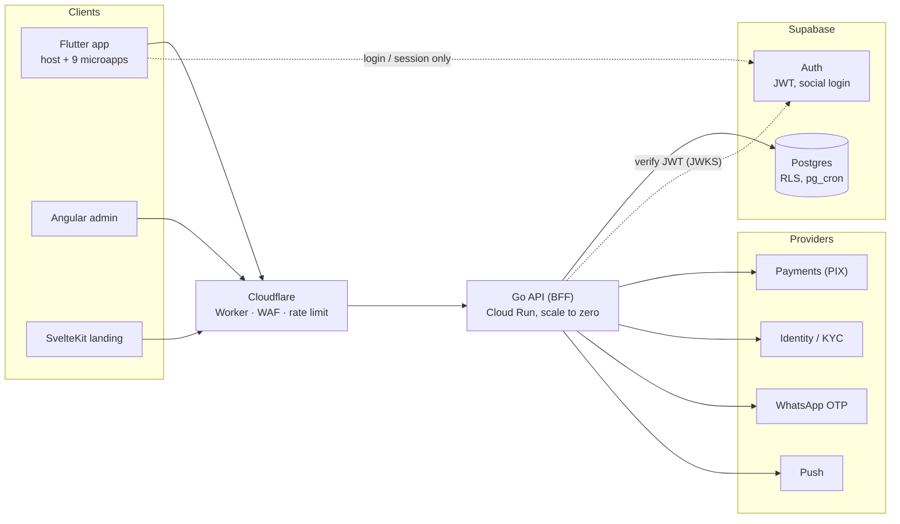
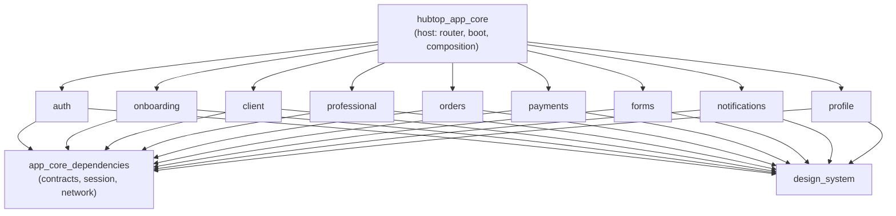
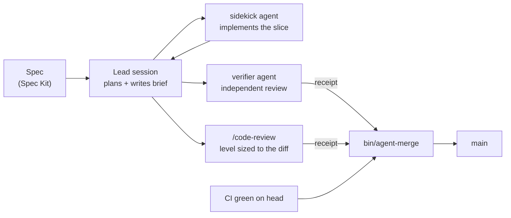

# HubTop — engineering case study

> How I built a two-sided services marketplace (Flutter + Go + Supabase) almost
> alone, by turning AI coding agents into a delivery pipeline with real gates.

This repository is the public, business-logic-free companion to HubTop. The
product code is private; this repo explains **what was built, why it was built
that way, and how it was delivered**, and it will grow into a small runnable
slice that you can clone and run (see [Roadmap](#roadmap-of-this-repo)).

**Product code is available for a walkthrough in an interview.**

<!-- TODO(phase-1): replace with a 20–30 s GIF of the client → offer → professional flow, recorded on fake data -->

<em>Demo GIF coming soon.</em>

---

## The problem

Hiring a plumber, electrician or cleaner in Brazil usually means asking around,
calling strangers and comparing prices blind. HubTop flips it:

1. A **client** describes the job once, for free.
2. The platform matches **professionals** by category, skills and distance.
3. Up to three of them send an offer with price and message.
4. The client picks one, the work happens offline, and both rate each other.

One account, two modes: the same person can be client and professional. The
platform charges only the professional, in prepaid credits bought with PIX.

The hard side of a marketplace is supply, not demand, so a recorded product
rule settles ties: **when client and professional experience conflict, the one
that retains professionals wins**, unless the client is hard-blocked.

## By the numbers

Counted from the private repository on 2026-11-07, about 11 months after the
first commit.

| | |
|---|---|
| Apps in one monorepo | **13**: 9 Flutter microapps, the Flutter host that composes them, a Go API, an Angular admin, a SvelteKit landing |
| Code (hand-written, no generated files) | ~90k lines of Dart, ~43k lines of Go |
| Database | 563 incremental Postgres migrations with RLS |
| History | 3,500+ commits, ~900 pull requests (787 merged) |
| Specs | 101 feature specs (Spec Kit) |
| Behaviour tests | 143 Gherkin `.feature` files, 792 scenarios |
| Go tests | 318 test files |
| Agent tooling | 6 Claude Code agents, 10 hooks, 32 skills, 30+ repo scripts |

## Architecture

The Flutter side is a **modular monolith**: one binary, one host, and a
dependency graph shaped like a star. The host is the only package that depends
on the microapps; no microapp depends on another. The host composes routes and
renders other modules' UI through typed contracts, not string lookups.

Inside a feature the layers are `presentation → domain ← data`. The domain has
no Flutter and no transport; a use case exists only when it holds a real
decision, never as a mandatory wrapper.

## Five decisions and why

Every key decision in the product repo is written as a short ADR
([Y-statement](https://medium.com/olzzio/y-statements-10eb07b5a177)): context,
alternatives, choice, what it buys, what it costs, and when to reopen it. These
are the five that shaped the system most.

### 1. Our own backend between the apps and every provider

**Choice:** all three clients talk only to a Go BFF. The app uses Supabase for
login and session and nothing else: zero direct table queries, zero direct
storage access. The public Supabase Data API was closed because no legitimate
client used it, and a surface nobody uses only serves an attacker.

**Why:** a mobile app can't be hot-patched. If queries lived in the app,
changing a provider would mean a store release and waiting for people to
update. With the BFF it's a backend deploy. It also puts authorization in one
place: identity comes from the verified JWT and scope from server context,
never from the request body. One OpenAPI contract serves three clients, and a
release is blocked if it breaks the live contract (`oasdiff`).

**Cost:** one more service to run and deploy.

### 2. Rewriting the backend from NestJS to Go, behind a stable contract

**Choice:** Go with the standard library `net/http`, `pgx`, `sqlc` and
`oapi-codegen`; NestJS was retired.

**Why:** the API runs on Cloud Run with scale to zero, so a cold start is a
user waiting. Measured cold start: **Go 0.59–0.67 s vs NestJS 9.8–10 s**. A
static binary in a distroless image, 6 direct dependencies, and SQL that is
written by hand but type-checked at compile time.

**How it was done safely:** an incremental migration behind the edge Worker,
with the same contract and the same black-box test suite run against both
backends. Dev was served entirely by Go on 2026-10-19 and NestJS was removed
two days later.

**Cost:** rewriting a working backend.

### 3. Flutter as a modular monolith of microapps

**Choice:** one Flutter codebase for iOS and Android, split into
domain microapps with Melos workspaces and generated Riverpod for dependency
injection.

**Why:** a tiny team can't maintain two native apps. Splitting by domain
(auth, onboarding, orders, payments…) keeps boundaries enforceable today and
leaves the door open to independent teams later, without paying for runtime
module loading now. An earlier string-based widget broker was removed because
it created hidden dependencies between modules.

**Cost:** native SDKs (KYC, push, social login) come through plugins.

### 4. Supabase for auth and the database, with RLS as defense in depth

**Choice:** managed Postgres and Auth in São Paulo, same region as the API
(~1–5 ms between them). Schema lives declaratively in the repo, every change
ships as an incremental migration, and RLS policies stay on even though the
backend is the authorization point.

**Why:** zero hours spent operating a database at this scale. The exit cost is
written down (a store release, a forced re-login, re-creating cron jobs and
vault secrets) together with the triggers that would reopen the decision.

**Cost:** the coupling above. A backend role without `BYPASSRLS` was tried and
rejected: four database round trips per request instead of one.

### 5. AI agents as a delivery pipeline, not as autocomplete

**Choice:** most code was written by Claude Code agents, but nothing reaches
`main` on an agent's word. Each change goes through:

- A **lead** session traces the flow, writes a complete brief and reviews the
  diff; a cheaper **sidekick** agent implements the slice.
- An independent **verifier** and a **code review** sized to the diff each
  save a receipt. `agent-merge` refuses to merge without both receipts
  plus green CI, and any new commit invalidates them.
- **Hooks** enforce the rules mechanically: a close gate runs the cheap checks
  before a session can stop, a scanner redacts secrets from tool output
  before the model ever sees them, and a guard makes sure each receipt can
  only be written by the role that owns it (the verifier can't approve the
  code review, a sub-agent can't approve on the lead's behalf).

**Why:** an agent's "done" is a claim, not evidence. Gates turn it into
evidence, which is what let one person ship ~900 pull requests without the
codebase rotting.

**Cost:** slower per change, and the tooling itself is a product to maintain.

## What I learned, and what I'd change

An architecture review in September 2026 scored the Flutter side **6/10 as a
modular monolith**. The boundaries were right; these were not:

- **Two DI systems.** Generated Riverpod on top, plus a legacy service locator
  underneath (185 lookups in 108 files). Every feature paid both costs. I would
  pick one container on day one and lint the other out.
- **The "shared core" became the real monolith.** Session, networking,
  telemetry, i18n, navigation and hundreds of lines of address logic ended up
  in one package. Shared code needs an owner and a size budget, or it fills up.
- **Domain duplicated per persona.** Client and professional profile use cases
  were 91–94 % identical. The mode split was the right UX boundary, but the
  wrong code boundary.
- **Uneven tests.** Auth had 1.14 lines of test per line of code; the client
  microapp had 0.06. Gherkin made behaviour readable, but coverage followed
  whoever was paying attention, so I'd gate it per module from the start.
- **Agents need guardrails before speed.** The biggest productivity jump came
  not from a better model but from receipts, hooks and a merge script that says
  no. I'd build the gates first next time.

## Roadmap of this repo

| Phase | What lands here | Status |
|---|---|---|
| 1 | This case study | Done, demo GIF pending |
| 2 | The agent pipeline, rebuilt generic and tested (see below) | Done |
| 4 | Public CI: hook and script tests, gitleaks over the full history, a fake-data check; Go, Flutter and migration/RLS jobs that switch on as soon as their code exists | Done |
| 3 | **HubTop Lite**: one end-to-end flow rebuilt from scratch (client creates an order → Go API stores it with identity from the JWT → professional sees it), with Supabase migrations, RLS tests and fake seed data | Planned |
| 5 | A 2–3 minute demo video, and optionally a Flutter web build on fake data | Planned |

Phases 3–5 are delivered through the same agent pipeline described above, so
the public pull requests show the whole path from spec to verifier to merge.

### The agent pipeline in this repo

A trimmed, generic version of the product's tooling, translated to English and
tested. Open the repo in Claude Code and it is active.

| File | What it does |
|---|---|
| [`AGENTS.md`](AGENTS.md), [`CLAUDE.md`](CLAUDE.md) | The rules and the delivery pipeline, and how the lead uses the agents |
| [`.claude/agents/sidekick.md`](.claude/agents/sidekick.md) | Implements a slice from a complete brief; never touches git or codegen |
| [`.claude/agents/verifier.md`](.claude/agents/verifier.md) | Clean-context review of the committed diff; on `APPROVED` saves the stage 1 receipt |
| [`.claude/hooks/close-gate.sh`](.claude/hooks/close-gate.sh) | Stop hook: blocks the close on deleted or skipped tests, analyzer or `go vet` failures; asks once for the verifier on sensitive paths |
| [`.claude/hooks/secret-output-scan.py`](.claude/hooks/secret-output-scan.py) | Redacts secrets from tool output (gitleaks plus built-in patterns) |
| [`.claude/hooks/review-receipt-guard.py`](.claude/hooks/review-receipt-guard.py) | Only the verifier saves stage 1, only the lead saves stage 2, nobody writes receipts by hand |
| [`bin/agent-review`](bin/agent-review) | Saves and checks the receipts, keyed by the diff's patch-id |
| [`bin/change-size`](bin/change-size) | Size caps per pull request and the `/code-review` level the diff needs |
| [`bin/agent-merge`](bin/agent-merge) | The only merge path: size, gates, both receipts, base contained, CI green, squash pinned to the reviewed sha |
| [`tools/gates.paths`](tools/gates.paths) | Files an agent can never merge: changes to the guardrails go to a person |
| [`specs/001-client-creates-order`](specs/001-client-creates-order/spec.md) | Example spec, and the first one HubTop Lite will implement |

Tests: `.claude/hooks/tests/hooks-test.sh` (30 cases) and
`tools/tests/receipts-test.sh` (18 cases).

## Repository rules

- Nothing is copied from the product repo without review, and `gitleaks` runs
  before every push.
- No real URLs, project IDs, emails or customer data. All data is fake.
- Folder names in kebab-case, without versions.

## About me

Miguel Angel Flores — mobile engineer working toward a Mobile Lead role.
Flutter, Go, Postgres, and building delivery systems where AI agents do the
typing and gates do the trusting.

<!-- TODO: add LinkedIn / contact links -->
